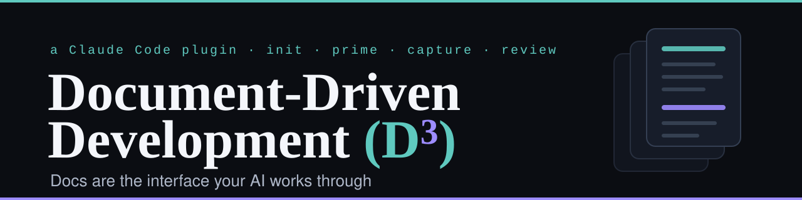
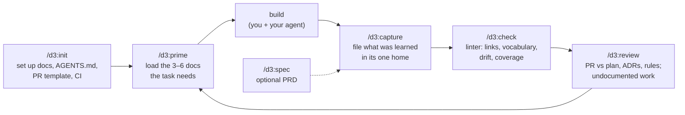

[](LICENSE)
[](CHANGELOG.md)
[](https://docs.claude.com/en/docs/claude-code)
[](https://agents.md)
[](tools/docs-check/README.md)

> **The repo holds the docs, so neither the people nor the agents have to guess from the code.**

Code says *what* the system does. It does not say **why** a rule exists, **which decisions** are
settled, **what broke last time**, or **what was agreed** for the feature being built. On most
teams that lives in a few people's heads and in chat history. An AI agent starting a session, or a
new engineer starting a job, has to reverse-engineer it from the code — slowly, and often wrong.

**D³** makes the repo hold it, in one shared system:

- **Typed homes** — every fact has exactly one place: a decision is an ADR, a shipped bug is a
  dated audit, a rule is a business-rule page, how a module works *today* is its module reference.
- **A loop** — `prime` loads the few docs a task needs before work starts; `capture` files what was
  learned after; `review` checks a PR against what was agreed; `check` keeps it all true in CI.
- **Plain Markdown for everyone** — people read it on GitHub, any agent reads it through
  `AGENTS.md`, and the linter runs with no AI at all.

It is the practice big engineering organizations rely on — design docs with acceptance criteria,
ADRs, blameless postmortems, PR templates, docs CI — packaged so a solo builder gets it in one
command and an experienced team gets it without the ceremony.

---

## The loop



| Command | What it does |
|---|---|
| `/d3:init [--backfill]` | Sets up `docs/` (taxonomy + machine-read vocabulary), templates, a lean `AGENTS.md` that `CLAUDE.md` imports, a PR template, the docs linter and its CI. **Dry run first, never overwrites**, and only *reports* on a repo that already has a docs system. `--backfill` drafts module references and *proposed* ADRs from existing code. |
| `/d3:prime <task>` | Loads the plan, ADRs, rules, module reference and flow that govern the task as a **compact context pack** — a line per doc, not a dump. `--diff [base]` picks the docs that cite the files a branch changed. |
| `/d3:capture --<kind> <what>` | Files new knowledge in its canonical home with the right template, then does the follow-through (indexes, the current-state doc, the docs check). **Lists the files and asks before writing.** |
| `/d3:spec <feature>` | Optional product spec (PRD): problem, users, non-goals, prioritized stories with Given/When/Then, `FR-###`, `SC-###`, open questions marked `[NEEDS CLARIFICATION]` — never guessed. |
| `/d3:check [--drift] [--fix]` | Runs the linter and turns its findings into fixes. |
| `/d3:review [PR#\|branch]` | Read-only: which acceptance criteria the change satisfies, which ADR or rule it contradicts, what behaviour changed with no doc updated, which citations it broke. |
| `/d3:status` | What is in flight, overdue for review, undocumented, or not yet graduated. |

`/d3:d3` prints the help; `/d3:d3 <verb>` routes to the verbs above.

### Example: the loop catching a real mistake

```text
> /d3:review main

Review of branch feat/unlimited against docs (base: main)
Plan: docs/plans/ads/posting-limits/README.md
Acceptance:   AC-2 ✗ "Given a Gold user, when they post, then the Gold quota applies" — a paid Gold user now skips it
Decisions:    ✗ membership.md:15 — `if (user.paid) return true` (src/ads/QuotaService.js:3) contradicts
                **Payment ≠ activation: the tier is granted by admin approval, not by paying.**
Undocumented: paid users unlimited — no doc in the diff changed; the method rename guard → check
              breaks the citation in membership.md (docs-check drift)
Verdict: needs changes
Follow-ups:   intended? /d3:capture --decision "Paid users post without a monthly limit", then update the rule
```

*(From a smoke test of this release; trimmed.)*

---

## What goes where

| Kind of knowledge | Home | Capture with |
|---|---|---|
| Future work, with numbered acceptance criteria | `docs/plans/{module}/{kebab}/README.md` | `--plan` |
| Product spec (optional PRD) | `docs/specs/NNN-{kebab}/spec.md` | `/d3:spec` |
| A hard-to-reverse decision | `docs/architecture/decisions/adr-NNNN-{kebab}.md` (MADR) | `--decision` |
| How the system fits / how a request moves | `docs/architecture/views/`, `docs/architecture/flows/` | `--architecture`, `--flow` |
| How a module works **today** | `docs/reference/modules/{module}.md` | `--module` |
| A domain, pricing or entitlement rule | `docs/reference/business-rules/{domain}.md` | `--rule` |
| A rule where one wrong edit costs money | `docs/reference/algorithms/` | `--algorithm` |
| Domain model, data model, threat model | `docs/reference/{domain,generated/data-model,security/threat-models}/` | `--domain`, `--data-model`, `--threat` |
| A shipped bug — dated, immutable | `docs/reference/audits/YYYY-MM-DD-{kebab}.md` | `--bug` |
| A production incident — blameless, owned action items | `docs/reference/incidents/` | `--incident` |
| Procedures, how-tos, onboarding | `docs/runbooks/`, `docs/guides/`, `docs/guides/tutorials/` | `--runbook`, `--guide`, `--tutorial` |
| A word the code uses | `docs/reference/glossary.md` | `--term` |

Your repo's own `docs/README.md` always wins over these defaults.

**Plans graduate.** When a plan ships, what outlives it moves to its permanent home (the module
reference, the rule, the flow), which links back. Nobody should have to read a stack of old plans —
or the code — to learn how the system works today.

---

## The docs check

A zero-dependency Node script (`tools/docs-check/check.mjs`, Node 18+) that `/d3:init` copies into
your repo and wires into CI. It needs no AI and no npm install.

- **Errors** (fail CI): frontmatter outside the vocabulary, broken links and anchors, Mermaid that
  does not parse, a reused ADR or spec number, an open `[NEEDS CLARIFICATION]` in a settled doc.
- **Warnings** (configurable): live plans without numbered acceptance criteria, **code citations
  that drifted** (`path#Symbol` / `path:line` whose file, lines or symbol are gone — or, with a lock,
  whose code changed), screenshots under `docs/`, incident action items without an owner,
  undocumented modules, plans that shipped without graduating.
- **Helpers**: `review-due`, `cites <path>` (which docs describe this code?), `drift --changed <base>`,
  `lock`, `--json`.

Use it as a GitHub Action without vendoring:

```yaml
- uses: actions/checkout@v4
- uses: abuammarsami/d3@v2
  with:
    args: --strict   # optional
```

Full reference: [tools/docs-check/README.md](tools/docs-check/README.md).

---

## Install

```text
/plugin marketplace add abuammarsami/d3
/plugin install d3@ammar-skills
```

Then, in a repo: `/d3:init`. For other agents (Codex, Cursor, Copilot, Gemini…) the result is plain
files they already read: `AGENTS.md` and `docs/`.

---

## Why, and how it compares

Context engineering beats prompt engineering: the win is the right durable knowledge in front of the
model at the right moment. Read the writeup —
**[Document-Driven Development (D³): Docs Are the Interface Your AI Works Through](https://ammar-portfolio-zeta.vercel.app/deep-dives/document-driven-development)**.

| | Spec-driven tools (Spec Kit, Kiro, BMAD) | Memory banks / generated wikis | **D³** |
|---|---|---|---|
| Scope | One feature, forward-looking | The whole repo | The whole repo, for its lifetime |
| Knows *why* (decisions, rules, past bugs) | Inside the feature's spec | No — generated from code | Yes — ADRs, rules, audits, incidents |
| Stays true after the feature ships | No | Regenerated | `capture` + graduation + drift check |
| Enforced in CI without AI | No | No | Yes |
| Works with any agent | Mostly | Per tool | Yes (`AGENTS.md` + Markdown) |

They combine well: a spec-driven tool can drive a feature while D³ keeps the repo's knowledge true,
and behaviour guidelines such as the Karpathy-inspired `CLAUDE.md` shape *how* the agent works while
D³ supplies *what is true* about the system.

**Deliberately not here:** generating code from specs, a cast of role personas, mandatory heavy
ceremony for small changes (a one-PR plan is five short sections), and LLM-written project overviews in
`AGENTS.md` — a 2026 study found those make agents *worse*, while human-written conventions and
commands help.

---

## FAQ

**Does it change my repo without asking?** No. Write verbs list every file and wait for a yes.
`init` is a dry run until you confirm, never overwrites a file, and on a repo that already has a docs
system it only reports what is missing.

**My team already has docs and a different layout.** Put a `<!-- docs-check:vocabulary -->` block in
your `docs/README.md` (or keep the one you have): D³ and the linter follow it.

**Do we need a PRD for everything?** No. A plan with numbered acceptance criteria is the default.
`/d3:spec` is for product questions that need their own review.

**Is `prime` dumping all my docs into context?** No — 3–6 docs, a line each. That is the point.

**Does it need graphify, a session log, Cursor rules?** No. They are used only when they already
exist ([shared/integrations.md](shared/integrations.md)).

---

## Testing

- `node --test tools/docs-check/test/*.test.mjs tools/init/test/*.test.mjs` — the linter and the
  scaffold, each rule proven both ways.
- `evals/` — behaviour cases for every verb (help, init safety, prime, prime --diff, capture routing,
  ADR numbering and supersede, incidents, spec, review, check, answering from docs), run with
  `claude plugin eval . --ablation with-without` to see the score with and without the plugin.

## Contributing

Issues and PRs welcome. This repo dogfoods itself: changes come with the doc that describes them, and
CI runs the docs check.

## License

[MIT](LICENSE) © Md. Abu Ammar
