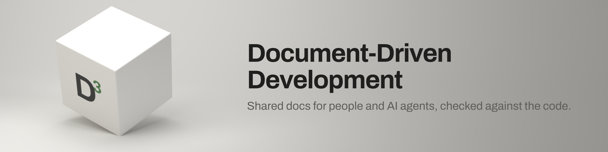
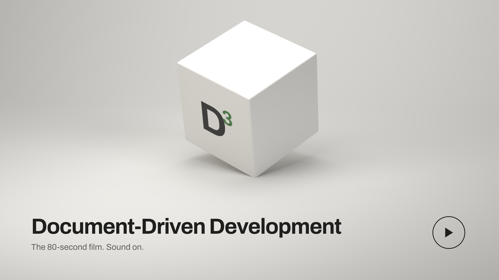
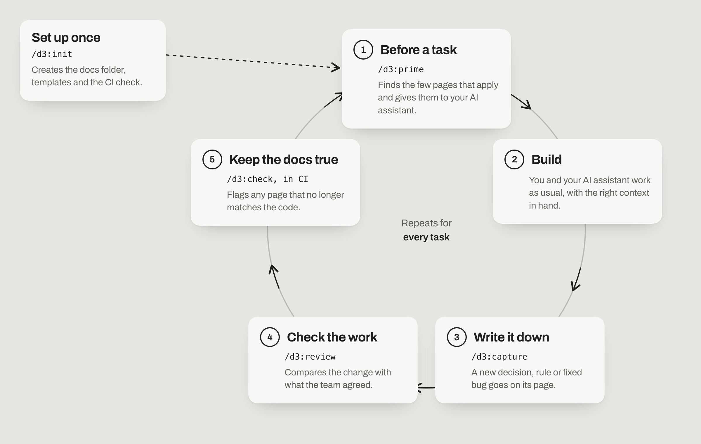

<picture>
  <source media="(prefers-color-scheme: dark)" srcset="assets/banner-dark.png">
  
</picture>

[](https://github.com/abuammarsami/d3/actions/workflows/ci.yml)
[](https://github.com/abuammarsami/d3/stargazers)
[](LICENSE)
[](CHANGELOG.md)
[](https://docs.claude.com/en/docs/claude-code)
[](https://agents.md)
[](tools/docs-check/README.md)

Every software team knows things the code doesn't say: why a rule exists, what the team decided, which
bugs were already fixed once. Some of it sits in Jira tickets, wiki pages and old chat threads, and
some only in people's heads. It's spread out, it drifts out of date, and an AI assistant working in
the repo usually can't see it.

**D³ (Document-Driven Development) writes that knowledge down inside the project, as short plain pages
that people and AI assistants both read, and checks in CI that the pages still match the code.**

[](https://github.com/abuammarsami/d3/releases/download/v2.0.0/d3-film.mp4)

## See it work


This is a real run. A business rule names the function that enforces it. Someone renames the
function, and the docs check points at the page that is now out of date, with the file and line.

## Quick start

In Claude Code:

```text
/plugin marketplace add abuammarsami/d3
/plugin install d3@ammar-skills
/d3:init
```

`init` shows you every file it would create and waits for your yes. It never overwrites a file, and
on a repo that already has docs it only reports what is missing.

## How it works

<picture>
  <source media="(prefers-color-scheme: dark)" srcset="assets/loop-dark.png">
  
</picture>

1. **Before a task**, `/d3:prime` finds the three to six pages that govern it (the plan, past
   decisions, business rules, how the module works) and gives the assistant one line about each.
2. **Build** as you normally would.
3. **Write it down.** When you learn something, `/d3:capture` files it on the right page and asks
   before it writes.
4. **Check the work.** `/d3:review` compares the branch with the plan's acceptance criteria and the
   decisions and rules it might break, and lists behaviour that changed with no page updated.
5. **Keep the docs true.** On every pull request, the docs check runs with no AI and fails or warns
   when a page is broken or points at code that changed.

The habits come from how large engineering teams already work: design docs with acceptance criteria,
written decision records (ADRs), blameless incident reviews and docs checked in CI. D³ sets them up
in one command, so a solo developer or a small team can use them without a documentation department.

## Who it's for

- **Developers at any level.** Juniors get the context seniors carry in their heads. Seniors stop
  answering the same "why is it like this?" question.
- **Solo builders and people who build by prompting.** Your assistant stops undoing decisions it never
  knew about.
- **Product, QA and business colleagues.** The pages are plain English on GitHub, so you can read
  the rules and decisions without reading code.

## Works with any AI assistant

| Part | Where it runs |
|---|---|
| The commands (`/d3:init`, `prime`, `capture`, `review`, `check`, `spec`, `status`) | Claude Code, as a plugin |
| The pages D³ writes (`docs/` and `AGENTS.md`) | Anywhere: Codex, Cursor, GitHub Copilot, Gemini and any person on GitHub read them with nothing installed |
| The docs check | Any CI, or as a GitHub Action. No AI, no npm install |

---

## Reference

### Commands

| Command | What it does |
|---|---|
| `/d3:init [--backfill]` | Sets up `docs/` with one place for each kind of knowledge and a machine-read vocabulary, page templates, a short `AGENTS.md` that `CLAUDE.md` imports, a PR template, the docs check and its CI. Dry run first, never overwrites, and only reports on a repo that already has a docs system. `--backfill` drafts module references and *proposed* ADRs from existing code. |
| `/d3:prime <task>` | Loads the plan, ADRs, rules, module reference and flow that govern the task as a compact context pack, one line per doc. `--diff [base]` picks the docs that cite the files a branch changed. |
| `/d3:capture --<kind> <what>` | Files new knowledge on its page with the right template, then updates the indexes, the current-state doc and runs the docs check. Lists the files and asks before writing. |
| `/d3:spec <feature>` | Optional product spec (PRD): problem, users, non-goals, prioritised stories with Given/When/Then, `FR-###`, `SC-###`, and open questions marked `[NEEDS CLARIFICATION]` instead of guessed. |
| `/d3:check [--drift] [--fix]` | Runs the docs check and turns its findings into fixes. |
| `/d3:review [PR#\|branch]` | Read-only. Which acceptance criteria the change satisfies, which ADR or rule it contradicts, what behaviour changed with no doc updated, which citations it broke. |
| `/d3:status` | What is in flight, overdue for review, undocumented, or not yet graduated. |

`/d3:d3` prints the help, and `/d3:d3 <verb>` routes to the commands above.

### Example: a review catching a real mistake

```text
> /d3:review main

Review of branch feat/unlimited against docs (base: main)
Plan: docs/plans/ads/posting-limits/README.md
Acceptance:   AC-2 ✗ "Given a Gold user, when they post, then the Gold quota applies" — a paid Gold user now skips it
Decisions:    ✗ membership.md:15 — `if (user.paid) return true` (src/ads/QuotaService.js:3) contradicts
                **Payment ≠ activation: the tier is granted by admin approval, not by paying.**
Undocumented: paid users unlimited — no doc in the diff changed; the method rename guard → check
              breaks the citation in membership.md (docs-check drift)
Verdict: needs changes
Follow-ups:   intended? /d3:capture --decision "Paid users post without a monthly limit", then update the rule
```

*From a smoke test of this release, trimmed.*

### Where each kind of knowledge goes

| Kind of knowledge | Page | Capture with |
|---|---|---|
| Future work, with numbered acceptance criteria | `docs/plans/{module}/{kebab}/README.md` | `--plan` |
| Product spec (optional PRD) | `docs/specs/NNN-{kebab}/spec.md` | `/d3:spec` |
| A decision that is hard to reverse | `docs/architecture/decisions/adr-NNNN-{kebab}.md` (MADR) | `--decision` |
| How the system fits together, how a request moves | `docs/architecture/views/`, `docs/architecture/flows/` | `--architecture`, `--flow` |
| How a module works today | `docs/reference/modules/{module}.md` | `--module` |
| A domain, pricing or entitlement rule | `docs/reference/business-rules/{domain}.md` | `--rule` |
| A rule where one wrong edit costs money | `docs/reference/algorithms/` | `--algorithm` |
| Domain model, data model, threat model | `docs/reference/{domain,generated/data-model,security/threat-models}/` | `--domain`, `--data-model`, `--threat` |
| A shipped bug, dated and never edited later | `docs/reference/audits/YYYY-MM-DD-{kebab}.md` | `--bug` |
| A production incident, blameless, with owned action items | `docs/reference/incidents/` | `--incident` |
| Procedures, how-tos, onboarding | `docs/runbooks/`, `docs/guides/`, `docs/guides/tutorials/` | `--runbook`, `--guide`, `--tutorial` |
| A word the code uses | `docs/reference/glossary.md` | `--term` |

Your repo's own `docs/README.md` always wins over these defaults.

**Plans graduate.** When a plan ships, what outlives it moves to its permanent page (the module
reference, the rule, the flow), which links back. Nobody should have to read a stack of old plans, or
the code, to learn how the system works today.

### The docs check

A Node script with no dependencies (`tools/docs-check/check.mjs`, Node 18+). `/d3:init` copies it
into your repo and wires it into CI. It needs no AI and no npm install.

- **Errors** fail CI: frontmatter outside the vocabulary, broken links and anchors, Mermaid that does
  not parse, a reused ADR or spec number, an open `[NEEDS CLARIFICATION]` in a settled doc.
- **Warnings** are configurable: live plans without numbered acceptance criteria, code citations that
  drifted (`path#Symbol` or `path:line` whose file, lines or symbol are gone or, with a lock file,
  whose code changed), screenshots under `docs/`, incident action items without an owner,
  undocumented modules, and plans that shipped without graduating.
- **Helpers:** `review-due`, `cites <path>` (which docs describe this code?), `drift --changed <base>`,
  `lock`, `--json`.

Use it as a GitHub Action without copying it in:

```yaml
- uses: actions/checkout@v4
- uses: abuammarsami/d3@v2
  with:
    args: --strict   # optional
```

Full reference: [tools/docs-check/README.md](tools/docs-check/README.md).

### How it compares

The longer write-up:
[Document-Driven Development (D³): Docs Are the Interface Your AI Works Through](https://ammar-portfolio-zeta.vercel.app/deep-dives/document-driven-development).

| | Spec-driven tools (Spec Kit, Kiro, BMAD) | Memory banks, generated wikis | D³ |
|---|---|---|---|
| Scope | One feature, planned ahead | The whole repo | The whole repo, for its lifetime |
| Knows why (decisions, rules, past bugs) | Inside that feature's spec | No, it is generated from code | Yes: ADRs, rules, audits, incidents |
| Stays true after the feature ships | No | Regenerated | `capture`, graduation and the drift check |
| Checked in CI without AI | No | No | Yes |
| Works with any agent | Mostly | Per tool | Yes, through `AGENTS.md` and Markdown |

They combine well. A spec-driven tool can drive one feature while D³ keeps the repo's knowledge
current, and behaviour guidelines such as the Karpathy-inspired `CLAUDE.md` shape how the agent works
while D³ supplies what is true about the system.

**Left out on purpose:** generating code from specs, a cast of role personas, heavy ceremony for small
changes (a one-PR plan is five short sections), and LLM-written project overviews in `AGENTS.md`. A
2026 study found those make agents worse, while human-written conventions and commands help.

### FAQ

**Does it change my repo without asking?** No. Commands that write list every file and wait for a yes.
`init` is a dry run until you confirm, never overwrites a file, and on a repo that already has a docs
system it only reports what is missing.

**Do we have to stop using Jira or Confluence?** No. Tickets track the work. D³ keeps the lasting
reasons (decisions, rules, past bugs) next to the code they explain, and a page can link to the
ticket it came from.

**My team already has docs with a different layout.** Put a `<!-- docs-check:vocabulary -->` block in
your `docs/README.md`, or keep the one you have. D³ and the docs check follow it.

**Do we need a PRD for everything?** No. A plan with numbered acceptance criteria is the default.
`/d3:spec` is for product questions that need their own review.

**Does `prime` dump all my docs into the context?** No. It loads three to six docs, one line each.

**Does it need graphify, a session log or Cursor rules?** No. They are used only when they already
exist ([shared/integrations.md](shared/integrations.md)).

### Testing

- `node --test tools/docs-check/test/*.test.mjs tools/init/test/*.test.mjs` runs the docs check and
  scaffold tests, each rule proven both ways.
- `evals/` has behaviour cases for every command (help, init safety, prime, prime --diff, capture
  routing, ADR numbering and supersede, incidents, spec, review, check, answering from docs). Run them
  with `claude plugin eval . --ablation with-without` to see the score with and without the plugin.

### Contributing

Issues and pull requests are welcome. This repo uses D³ on itself: a change comes with the doc that
describes it, and CI runs the docs check.

## License

[MIT](LICENSE) © Md. Abu Ammar
