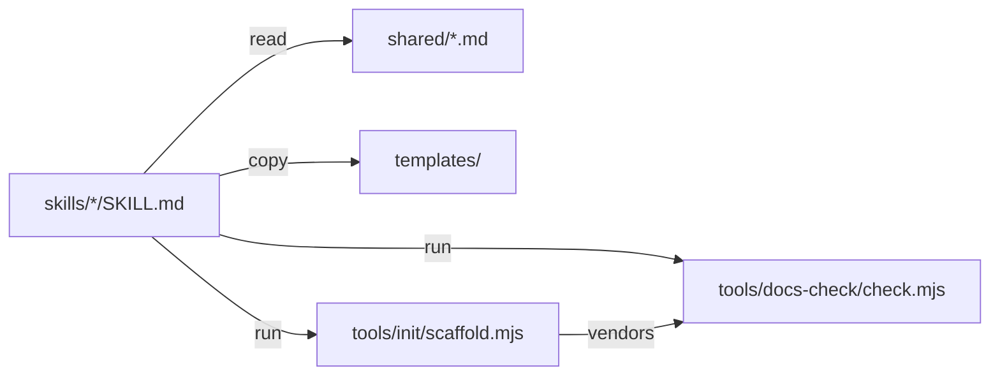

# D³ v2

## In plain language

v1 helped an agent file and find documents. v2 makes the repo itself the place where people and any
coding agent learn how the system works and why, without reading the code: it sets the docs system up
(`init`), keeps a plan's acceptance criteria next to the work, checks pull requests against what was
agreed (`review`), and catches docs that stopped being true (`check`). The doc system it packages is
the one built for the Partners (bareegaree) repo in its "Documentation 2027" programme, generalized.

**What you need to decide.** Nothing to build v2. To release it: push the `v2` branch, open the PR, tag
`v2.0.0` and move the `v2` tag (the Action is referenced as `abuammarsami/d3@v2`).

## Why

- A gap analysis (2026-11-09) against big-tech practice found v1 had no acceptance criteria, no
  bootstrap for an empty repo, no enforcement (the docs check was referenced but not shipped), no PR
  review against the docs, and line-number citations that rot.
- The single 303-line skill loaded everything on every call ([ADR-0001](../../../architecture/decisions/adr-0001-split-verb-skills.md)).
- Personal integrations of the author's setup sat in the core steps.

## Goals and non-goals

- **Goals:** one docs system people and any agent share; enforced without AI; safe on existing repos.
- **Non-goals:** generating code from specs; a mandatory PRD; role personas; generated overviews in
  `AGENTS.md`; changing any existing repo (Partners included) without its owner running a write verb.

## Acceptance criteria

- **AC-1** Given a repo with no docs, when `/d3:init` runs, then it shows every file it would write and
  writes nothing until confirmed; after `--apply`, the repo passes its own docs check with 0 errors.
- **AC-2** Given a repo that already has a docs system (a vocabulary block), when `/d3:init` runs, then
  it only reports what is missing and writes nothing.
- **AC-3** Given the Partners repo, when the D³ docs check runs, then it reports the same blocking
  problems (0) as the Partners checker it was ported from.
- **AC-4** Given a live plan without numbered acceptance criteria, when the docs check runs, then it
  warns; given a reused ADR number or an open `[NEEDS CLARIFICATION]` in a settled doc, it errors.
- **AC-5** Given a doc citing a renamed symbol, a deleted file or lines past the end, when the drift
  check runs, then each is reported, and historical records are not.
- **AC-6** Given a branch that contradicts a documented business rule, when `/d3:review` runs, then it
  quotes the rule, flags the undocumented change and edits nothing.
- **AC-7** Given any write verb, when it runs, then it lists the files and their key content and waits
  for a yes before writing.
- **AC-8** Given a pull request whose frontmatter contains a newline, when the check runs in GitHub
  Actions, then no workflow command can be injected.

## Design

Verb skills under `skills/`, shared rules under `shared/`, templates under `templates/`, and two
zero-dependency tools under `tools/` ([ADR-0001](../../../architecture/decisions/adr-0001-split-verb-skills.md),
[ADR-0002](../../../architecture/decisions/adr-0002-symbol-citations-and-drift.md)).

| Box or arrow | Code it comes from |
|---|---|
| skills read shared | `skills/capture/SKILL.md` (links `../../shared/safety.md`) |
| skills run the check | `skills/check/SKILL.md`, `skills/prime/SKILL.md` (`check.mjs cites`) |
| scaffold vendors the check | `tools/init/scaffold.mjs` (copies `tools/docs-check/`) |

### Decisions

| # | Decision | Why | Alternatives rejected |
|---|---|---|---|
| D1 | Plans are the primary doc; a spec is optional | Partners plans already carry the PRD's job; a separate PRD pays off only with separate product and engineering owners | Required spec for every feature |
| D2 | Port the Partners checker instead of writing one | Proven on ~640 docs; parity is testable | A new linter from scratch |
| D3 | Zero npm dependencies | It is vendored into other repos and must run in CI untouched | Keep `yaml`, `markdown-it`, `mermaid` |

## Tasks

| # | Task | Satisfies | Files |
|---|---|---|---|
| T001 | Zero-dependency linter + D³ rules + parity run | AC-3, AC-4, AC-5, AC-8 | `tools/docs-check/**` |
| T002 | Templates and scaffold | AC-1, AC-2 | `templates/**`, `tools/init/**` |
| T003 | Split skills, shared rules | AC-6, AC-7 | `skills/**`, `shared/**` |
| T004 | Evals, CI, Action, README, CHANGELOG, dogfood docs | all | `evals/**`, `.github/**`, `action.yml`, `docs/**` |

## Rollout and rollback

Release from branch `v2` as 2.0.0. `/d3:d3 <verb>` keeps v1 invocations working. Rollback: users pin
`d3@ammar-skills` to 1.0.1; repos that ran `init` keep plain Markdown files that need nothing from D³.

## Test plan

- `node --test tools/docs-check/test/*.test.mjs tools/init/test/*.test.mjs` — AC-1 to AC-5, AC-8.
- Parity: the D³ check against the Partners checker on the Partners repo (read-only) — AC-3.
- `claude plugin eval . --scaffold --ablation with-without` — AC-1, AC-2, AC-6, AC-7.

## Done when

- [x] Tests, parity and smoke runs pass (2026-11-09).
- [ ] Evals reviewed at full runs; PR merged; `v2.0.0` and `v2` tags pushed.
- [ ] Graduation: this plan's lasting content lives in the README, `tools/docs-check/README.md` and the ADRs.
