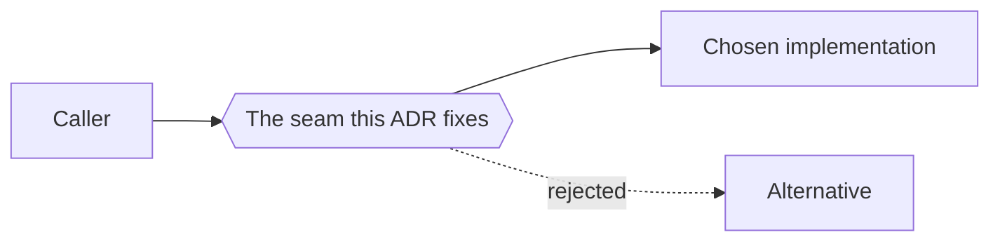

# ADR-NNNN: <Decision title>

*Write an ADR only when the decision is **hard to reverse**, **surprising without context**, and **the
result of a real trade-off**. Anything less is a line in the plan's Decisions table.*

*[MADR](https://adr.github.io/madr/) 4 shape, with this repository's frontmatter and numbering: the
next number is `max(NNNN) + 1` over `adr-*.md`, four digits. An ADR is **immutable** once accepted; to
change a decision, write a new ADR with `supersedes:` and stamp this one's `superseded-by:` and status.*

## Status

`proposed` — *or* `accepted` (YYYY-MM-DD, by whom) / `rejected` / `superseded by ADR-MMMM` / `deprecated`.
The frontmatter `status:` carries the same word.

## Context and problem statement

*What forces a decision, in two to four sentences, and the question it answers. Be concrete: what was
happening in the code (`file:line`), the system or the market; what constraints are non-negotiable.
A reader six months from now should understand why this was on the table from this section alone.*

## Decision drivers

- *What "good" means here: the qualities this decision optimises (security, cost, operability, time).*

## Considered options

1. *Option A — name*
2. *Option B — name*
3. *Option C — do nothing*

## Decision outcome

**Chosen: option *X*, because** *one sentence tying it to the drivers.*

*How it works, in one to three paragraphs: enough that an engineer could implement it from this ADR.
A diagram helps when the decision changes a structure or a flow.*

### Consequences

- **Good:** *what becomes easier; what problem it solves.*
- **Bad:** *what becomes harder; what we are now locked into.*
- **Neutral:** *what questions it leaves open; what would make us revisit it.*

### Confirmation

*How compliance is checked: the test, the CI guard, the review rule that fails if the code drifts from
this decision.*

## Pros and cons of the options

### Option A — <name>

- Good, because *…*
- Bad, because *… (specific: "needs a Redis Streams consumer nobody here has operated", not "complex")*

### Option B — <name>

- Good, because *…*
- Bad, because *…*

## More information

- *Related ADRs, the plan, audits, and external sources.*
