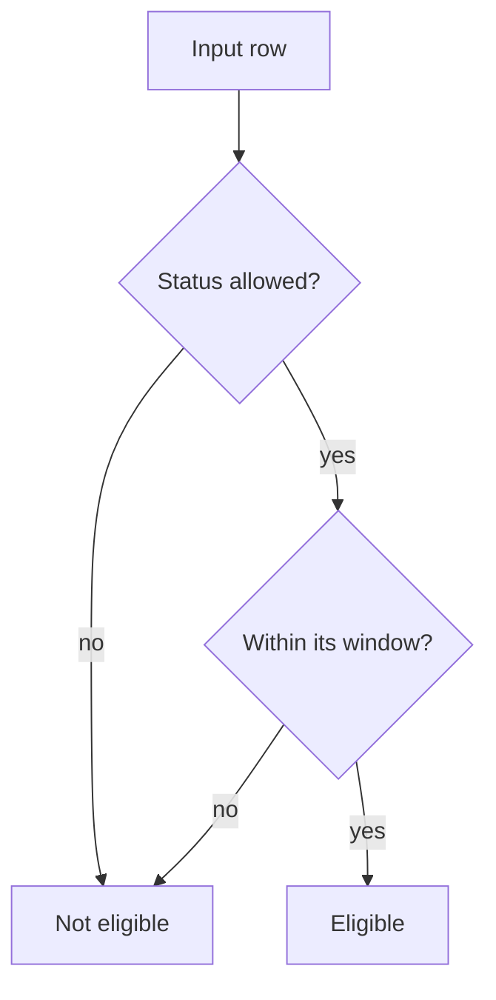

# <Algorithm title>

## In plain language

*What the rule decides and why a wrong edit is expensive (money, visibility, trust).*

## Where it lives

| Part | Code (`file:line`) |
|---|---|
| *The single source (function, procedure, class)* | *`path/to/rules.ts#calculatePrice`* |
| *Every caller* | |

## Inputs and outputs

| Input | Type | Meaning | Allowed values |
|---|---|---|---|
| | | | |

| Output | Type | Meaning |
|---|---|---|
| | | |

## How it decides

*Example. Replace with the real decision order; every branch cites its line.*

## Invariants

*Each invariant is backed by a named test, or marked **untested**.*

| # | Invariant | Test that pins it |
|---|---|---|
| I1 | *Always true, whatever the input* | *`FullyQualifiedName~...`* or **untested** |

## Complexity and the indexes it relies on

*Time and space in terms of the table sizes; the index each predicate uses; what happens at ten times
today's volume.*

## Edge cases

| Case | Behaviour | Why |
|---|---|---|
| *Null, empty, boundary dates, time zones (host clock vs UTC vs the business's local zone), duplicates* | | |

## Changing it safely

*What else must change in the same PR (callers, caches, the sitemap, the mobile app), and which tests
will go red if it is broken.*
