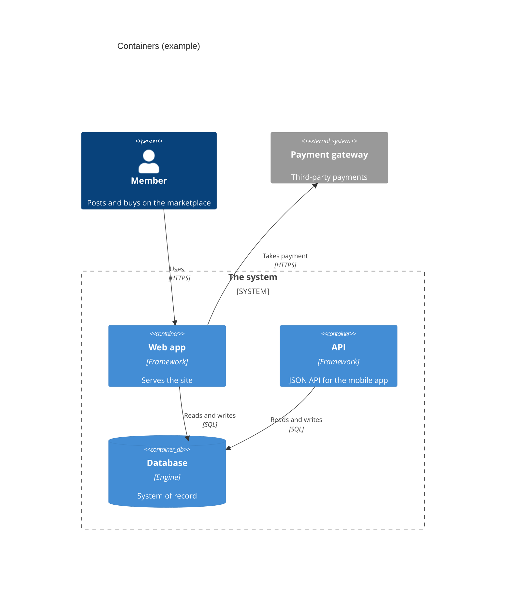

# <View title>

*One view answers one question at one zoom level. Pick the [C4](https://c4model.com/) level (context,
container or component; never code, the knowledge graph covers that) and the
[arc42](https://arc42.org/overview) section it belongs to (3 context, 5 building blocks, 6 runtime,
7 deployment, 8 cross-cutting concepts).*

## In plain language

*What this picture shows, in two or three sentences.*

## The view

*Example: a container view. Replace every element with what the code actually has.*

## Where each element comes from

*Every box and arrow above, with the code that proves it. A row with no citation is a row to delete.*

| Element | Kind | Code (`file:line`) | Notes |
|---|---|---|---|
| *Web app* | *container* | *`web/src/main.ts#bootstrap`* | |
| *web → Database* | *relationship* | *`src/.../orders-repository.ts#OrdersRepository`* | |

## Responsibilities and boundaries

| Element | Owns | Never does |
|---|---|---|
| | | |

## Decisions behind this view

- *ADR links, one line each on what they fixed in place.*

## Risks and known gaps

- *What this view shows that is not as it should be, each linked to a plan or an audit.*

## Verified

*Date, commit, and how the view was checked against the code (for example the code search or graph query used).*
