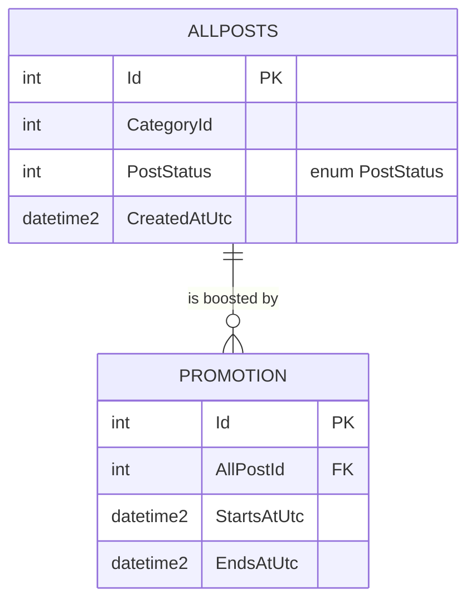

# <Context> data model — notes

*The ER diagram and column lists are **generated** from `database/` into `{context}.md` (Documentation
2027 P4) and are never edited by hand. This file holds what the scripts cannot say: why a column exists,
what a status id means, which rows are legacy. Until the generator lands, a hand-drawn diagram may sit
here, each entity cited to the script that creates it.*

## In plain language

*What this part of the database records, in two or three sentences.*

## Entities

*Example. Replace with the real tables; cite the CREATE TABLE script for each.*

| Entity | Script (`file:line`) | Notes |
|---|---|---|
| | | |

## Column notes

| Table.Column | Why it exists | Values and their meaning |
|---|---|---|
| | | *Cite the enum or the `MasterTable` ids* |

## Invariants the database enforces

| Rule | Enforced by (constraint, index, trigger, procedure) |
|---|---|
| | |

## Legacy and migration notes

*Columns nobody writes, tables a programme is retiring, and the delete-safe manifest entry for each.*
