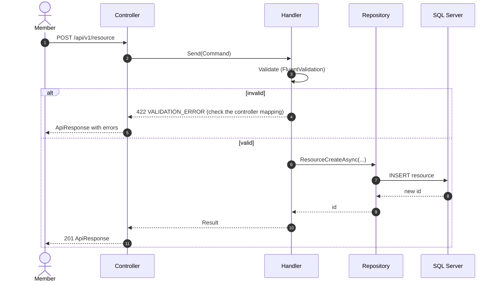

# <Flow title>

## In plain language

*The flow as the user experiences it, in three to five sentences.*

## Trigger and outcome

| | |
|---|---|
| **Trigger** | *The request, job or callback that starts it* |
| **Happy outcome** | *What is true afterwards: rows written, events raised, what the user sees* |
| **Entry points** | *Web route, API route, worker job* |

## Sequence

*Example. Replace each participant and message with the real class, handler, procedure or table.*

## Where each step comes from

| # | Step | Code (`file:line`) |
|---|---|---|
| 1 | *POST /api/v1/resource* | *`src/api/resources.controller.ts#create`* |
| 2 | *Send(Command)* | |

## Refusals

*Every way the flow can stop, with the error code and the HTTP status (CLAUDE.md §11: 400 = did not
parse, 422 = parsed and refused).*

| Condition | Code | Status | Raised at |
|---|---|---|---|
| | | | |

## Side effects

*Cache tags invalidated, notifications queued, audit rows, money moved.*

## Tests that pin this flow

- *`FullyQualifiedName~...` — what it proves.*

## Verified

*Date, commit, and who traced the diagram against the code.*
