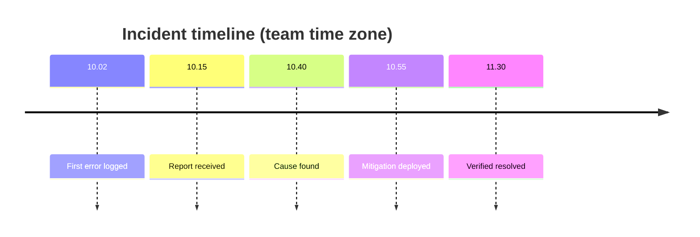

# <Incident title>

*Blameless: describe systems and decisions, not people. Written after mitigation, so it starts `resolved`; use `active` only
while the incident is still live. A recurrence is a new file, never an edit of this one. Never paste a secret, a token,
a customer's phone number or email, or an exploit that still works: name the `UserId` or the `RequestId`, nothing more.*

## Summary

| | |
|---|---|
| **Impact** | *Who was affected, how many, what they could not do; money at risk, in the currency it was charged in* |
| **Detected** | *YYYY-MM-DD HH:MM in the team's zone (and UTC), and how: a customer, an alert, a log search* |
| **Mitigated** | *Time, and the action* |
| **Resolved** | *Time, and the PR* |
| **Severity** | *See the scale below* |
| **Estate** | *Production or dev; which services or hosts, the database, a third party* |

**Severity scale.**

| Level | Meaning | Examples on this platform |
|---|---|---|
| **SEV1** | Outage, or money or personal data at risk | The site or API down; a payment settled twice or not at all; personal data exposed |
| **SEV2** | A feature down for everyone who uses it | Sign-up fails; one-time codes are not sent; the background worker stopped |
| **SEV3** | Degraded, or down for some | Slow pages; one category's photos missing; one partner's dashboard wrong |
| **SEV4** | Cosmetic, no customer impact | A wrong label; a log line at the wrong level |

## In plain language

*What happened, why, and what changed so it cannot happen again, for the owner.*

## Timeline

## Detection and response

| Question | Answer |
|---|---|
| What told us? | *The customer, the alert, the log line; quote it* |
| Time to detect | *From the first error to someone knowing* |
| Time to mitigate | *From knowing to customers no longer affected* |
| Which runbook was used? | *Link it, or "none existed" (then add one to the follow-ups)* |
| Evidence | *Request or trace ids, log queries, dashboard links, dead-letter ids — never the data itself* |

## Root cause

*The defect at `file:line`, and why it showed only here, only now, only in this environment.*

*Optional: five whys, each answer one line, ending at a cause the team controls.*

## Contributing factors

- *What made it possible, or made it worse, or slowed detection.*

## What went well

- *What limited the damage: a guard, an alert, a kill switch. Keep these.*

## What went wrong

- *Where process, tooling or design let it through or slowed the response.*

## Where we got lucky

- *What could have made it far worse and did not — by chance, not by design. Each is a follow-up.*

## What we changed

| Change | PR | Prevents |
|---|---|---|
| | | |

## What we considered and did not change

- *Each with the reason.*

## Action items

*Every row has an owner and a ticket; the docs check flags a row without an owner. Type is
**prevent** (it cannot happen again), **mitigate** (it hurts less) or **detect** (we know sooner).*

| Action | Type | Owner | Ticket |
|---|---|---|---|
| *Add an alert on …* | detect | *<name>* | *#123* |
