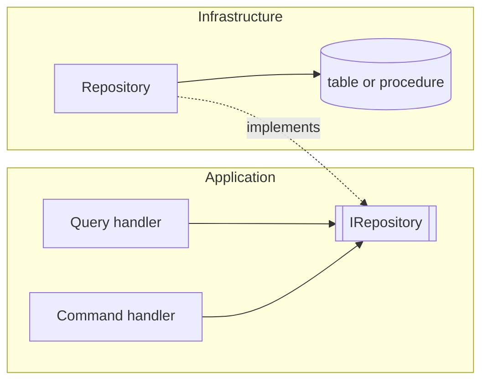

# <Module> — how it works today

*Current state only. Why it is built this way belongs in an ADR; how it will change belongs in a plan.*

## In plain language

*What the module does for users, in two or three sentences.*

## Where it lives

| Layer | Folder or project | Entry points |
|---|---|---|
| Domain | `src/<module>/domain/...` | *Entities, rules* |
| Application | `src/<module>/application/...` | *Use cases, commands and queries* |
| Infrastructure | `src/<module>/infrastructure/...` | *Repositories, external calls* |
| API / UI | `src/<module>/api/...` | *Routes, screens* |
| Database | `database/...` | *Tables, procedures* |

## Components

*Example. Replace with the module's real components.*

| Component | Code (`file:line`) | Responsibility |
|---|---|---|
| | | |

## Configuration and switches

| Key | Default | Effect |
|---|---|---|
| | | |

## Caching

*Keys, TTLs and the tags that invalidate them.*

## Errors it returns

| Code | Status | When |
|---|---|---|
| | | |

## Tests

*The test classes that cover the module, by name.*

## Known gaps

*Each linked to a plan or an audit.*
