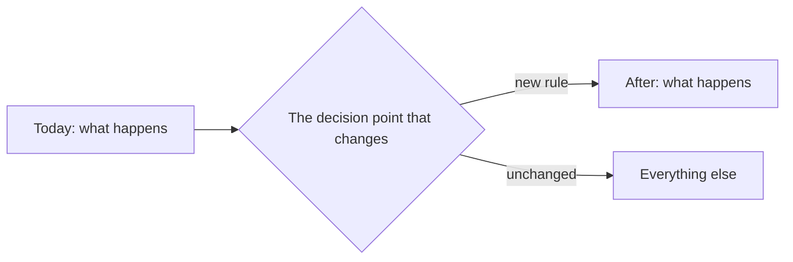

# <Plan title>

*One plan does the job of a PRD (what and why, for users) and a design doc (how). Keep both halves
short; link instead of re-explaining. For a one-PR change, fill In plain language, Scope, Acceptance
criteria and Done when, and delete the rest.*

## In plain language

*Three to six sentences for someone who does not read code: what changes for a user, why now, and what
the owner has to decide. Use an analogy for anything mechanical.*

**What you need to decide.** *A numbered list, or "nothing".*

## Why

*The problem, with evidence: the report quoted verbatim, the measurement, the query, the code citation
(`path#Symbol` or `path:line`) where the behaviour lives today.*

## Goals and non-goals

- **Goals:** *the outcomes this plan commits to, measurable where possible.*
- **Non-goals:** *what a reader might expect this plan to do, and it deliberately does not — with where
  that work goes instead.*

## Scope

- **In:** *what this plan delivers.*
- **Out:** *what it does not touch.*

## Acceptance criteria

*Numbered, so tasks, reviews and pull requests can say which ones they satisfy. Each is one
Given / When / Then a tester could check without asking you. (EARS — "When <trigger>, the system shall
<response>" — is fine too.) Unknowns are written `[NEEDS CLARIFICATION: <question>]`, never guessed;
the docs check refuses one in an `active` plan.*

- **AC-1** Given *<state>*, when *<action>*, then *<observable result>*.
- **AC-2** Given *…*, when *…*, then *…*.

## Design

*Link the architecture view and the flow this changes; do not re-explain the system. Describe only the
delta. A diagram of the new behaviour goes here, verified against the code it will touch.*

| Box or arrow | Code it comes from |
|---|---|
| *The decision point* | *`src/.../handler.ext#Symbol`* |

### Decisions

| # | Decision | Why | Alternatives rejected |
|---|---|---|---|
| D1 | | | |

*A decision that is hard to reverse, surprising without context, and a real trade-off gets its own ADR;
link it here.*

### Alternatives considered

*The serious options you did not take, each with the one reason it lost. "Do nothing" is an option.*

### Cross-cutting concerns

| Concern | Impact and handling |
|---|---|
| Security | *New input, new permission, new secret? Link the threat model.* |
| Privacy | *Personal data collected, stored, shown or deleted?* |
| Observability | *The log, metric or alert that will tell you it works — and that it broke.* |
| Performance and cost | *Load, query count, indexes relied on.* |
| Data migration | *Backfill, ordering, reversibility.* |

## Tasks

*One task is about one pull request. Each names the acceptance criteria it satisfies. `[P]` marks a
task that can run in parallel with the one before it.*

| # | Task | Satisfies | Files | Tests that pin it |
|---|---|---|---|---|
| T001 | | AC-1 | | |
| T002 [P] | | AC-2 | | |

## Rollout and rollback

*Order of deployment (schema before or after code, and why), feature flags, who is exposed first, and
the exact steps to roll back — including what happens to data written in between.*

## Test plan

*Which tests fail if this is reverted. Name them, and map each to the AC it proves.*

## Done when

- [ ] *Every acceptance criterion passes, each pinned by a named test.*
- [ ] Docs follow-through: the folder index, the plans index and roadmap, the progress log the repo keeps.
- [ ] **Graduation:** what outlives this plan (how the module works now, the rule, the flow) is in its
      permanent home, which links back here. The plan stays as the record of how it got there.

## Open questions

1. *Each with who answers it.*

## References

- *ADRs, audits, external standards.*
