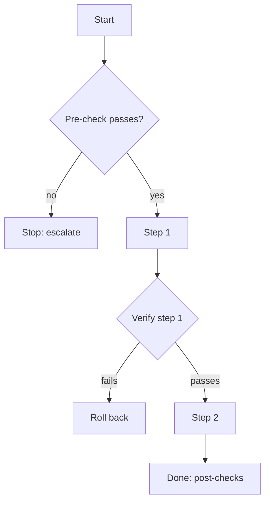

# <Runbook title>

*Every step is a command an operator can paste, with its expected output, a check, and a way back.
Name configuration keys, never their values.*

## In plain language

*What this procedure does and what can go wrong, for the owner.*

## When to use this

*The symptom or the trigger, quoted as the operator will see it: the alert text, the error, the date.
And when **not** to use it.*

## Before you start

| Need | Where it comes from |
|---|---|
| *Access (Plesk, SSMS, GitHub environment)* | *Who grants it* |
| *A backup taken* | *The step that takes it* |
| *A maintenance window* | *Who agrees it* |

## Procedure



1. **Pre-check.** *The exact command or query, and the output that means "go".*

   ```text
   <command>
   ```

   **Expect:** *the output.* **If not:** *stop, go to Escalation.*

2. **Step.** *One action per step. Copy-paste commands. Name every value.*

## Verify

*The checks that prove it worked, each with its expected output.*

## Roll back

*The exact reverse, step by step. When it is no longer possible to roll back, say so before the step
that crosses that line.*

## Common failures

| Symptom | Cause | Fix |
|---|---|---|
| | | |

## Escalation

| Situation | Who | How |
|---|---|---|
| | | |

## History

| Date | Run by | Outcome | Notes |
|---|---|---|---|
| | | | |
