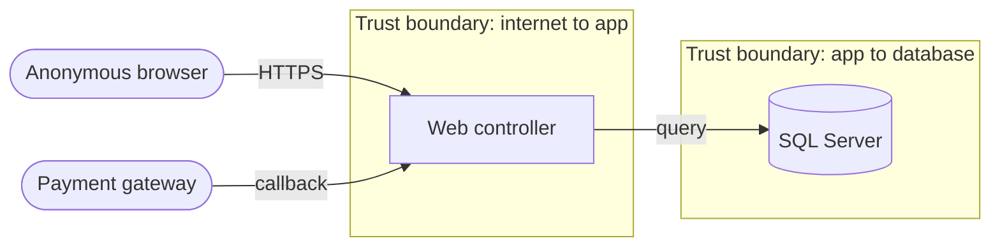

# <Threat model title>

*[STRIDE](https://learn.microsoft.com/en-us/azure/security/develop/threat-modeling-tool-threats) per
element that crosses a trust boundary. Every threat links a mitigation in code (`file:line`) or an
open item. Never paste a secret, a live token or a customer's data here.*

## In plain language

*What an attacker could try here, and what stops them, for the owner.*

## Scope

| | |
|---|---|
| **Surface** | *Public web, signed-in web, Super-Admin, API, mobile, worker, or payment callbacks* |
| **Assets** | *What is worth stealing or breaking: money, PII, accounts, listings* |
| **Actors** | *Anonymous visitor, member, partner, admin, gateway, attacker* |
| **Out of scope** | |

## Data flow and trust boundaries

*Example. Replace with the real elements; each boundary is a dashed subgraph.*

## Threats

| # | Element | STRIDE | Threat | Mitigation (`file:line`) | Status |
|---|---|---|---|---|---|
| T1 | | **S**poofing | | | mitigated / open |
| T2 | | **T**ampering | | | |
| T3 | | **R**epudiation | | | |
| T4 | | **I**nformation disclosure | | | |
| T5 | | **D**enial of service | | | |
| T6 | | **E**levation of privilege | | | |

## Open items

| # | Threat | Risk (likelihood × impact) | Owner | Plan |
|---|---|---|---|---|
| | | | | |

## Verified

*Date, commit, and how each mitigation was confirmed (test name, request replayed, query).*
