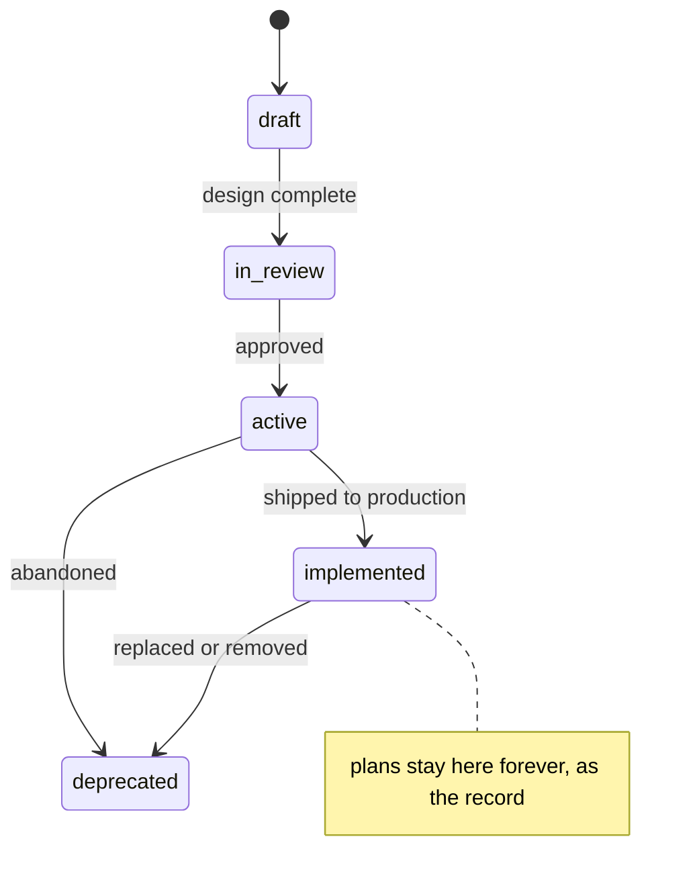

# <Project> documentation

This is the entry point for all documentation, and **the single source of the docs taxonomy**: where
each kind of document lives, the frontmatter every document carries, and the status values it may use.
The D³ skills and the docs check both read this file, so a rule changed here changes for both.

> **For people and agents:** start here. `AGENTS.md` at the repo root holds the commands and
> conventions; this file is the map of everything else.

**In plain language.** Documents are sorted by *what kind of question they answer*, not by feature.
"How do I do X?" is a guide or a runbook. "What is the rule for X?" or "how does X work today?" is
reference. "Why is X built this way?" is architecture or an ADR. "What are we going to build?" is a
plan. Each kind has one home, so a fact is written once and found in one place.

## Folder taxonomy

[Diátaxis](https://diataxis.fr/) decides the folder: every document is a **tutorial** (learning), a
**how-to** (one task), **reference** (facts to look up) or an **explanation** (how and why it fits).
Plans and legacy material sit outside Diátaxis: they are project records.

| Folder | What lives here | Diátaxis kind |
|--------|-----------------|---------------|
| [architecture/](architecture/) | arc42 views, C4 diagrams, runtime flows, and the immutable ADRs | Explanation |
| [plans/](plans/) | Feature, migration and refactor plans, one folder per plan, grouped by module | (project record) |
| [specs/](specs/) | Optional product specs, when the what-and-why needs its own review | (project record) |
| [runbooks/](runbooks/) | Operational procedures: deploy, rotate, recover | How-to |
| [guides/](guides/) | Developer how-tos and standards; [`guides/tutorials/`](guides/tutorials/) for learning paths | How-to · Tutorial |
| [reference/](reference/) | Facts that change slowly: business rules, modules, algorithms, domain, security, generated catalogues, audits, incidents, glossary | Reference |
| [legacy/](legacy/) | How a retiring system worked, for migration context only | (archive) |
| [templates/](templates/) | The starting shape of every document type | — |

### Where each kind of knowledge lives

| Kind of knowledge | Home | `type:` | Template |
|---|---|---|---|
| Future work (feature, migration, refactor), with numbered acceptance criteria | `plans/{module}/{kebab}/README.md` | `plan` | [plan](templates/plan.md) |
| Product spec (optional PRD) | `specs/NNN-{kebab}/spec.md` | `spec` | [spec](templates/spec.md) |
| Architectural decision | `architecture/decisions/adr-NNNN-{kebab}.md` (next number, 4 digits) | `adr` | [ADR](templates/adr.md) |
| Architecture view (arc42 section; C4 context, container, component; deployment) | `architecture/views/` | `architecture` | [architecture view](templates/architecture-view.md) |
| Runtime flow (one sequence diagram, end to end) | `architecture/flows/` | `flow` | [flow](templates/flow.md) |
| Current state of a module ("how it works today") | `reference/modules/{module}.md` | `reference` | [module reference](templates/module-reference.md) |
| Domain, pricing or entitlement rule | `reference/business-rules/{domain}.md` | `reference` | [business rule](templates/business-rule.md) |
| Algorithm (a rule where one wrong edit costs money or visibility) | `reference/algorithms/` | `algorithm` | [algorithm](templates/algorithm.md) |
| Domain model (class diagrams, state machines of status enums) | `reference/domain/{context}.md` | `reference` | — |
| Data model (ER diagram per bounded context) | `reference/generated/data-model/` (generated) + hand-written `{context}.notes.md` | `data-model` | [data model](templates/data-model.md) |
| Threat model (STRIDE, per surface) | `reference/security/threat-models/` | `threat-model` | [threat model](templates/threat-model.md) |
| Glossary term | `reference/glossary.md`, one `###` entry per term | `glossary` | [glossary entry](templates/glossary-entry.md) |
| Shipped bug or parity finding | `reference/audits/YYYY-MM-DD-{kebab}.md`, **dated and immutable** | `audit` | [audit](templates/audit.md) |
| Production incident (blameless postmortem) | `reference/incidents/{kebab}.md` | `incident` | [incident](templates/incident.md) |
| Operational procedure | `runbooks/{kebab}.md` | `runbook` | [runbook](templates/runbook.md) |
| Developer how-to or standard | `guides/{kebab}.md` | `guide` | [guide](templates/guide.md) |
| Learning path (clone to a first traced change) | `guides/tutorials/` | `tutorial` | [tutorial](templates/tutorial.md) |
| Material about a retiring system | `legacy/` | `legacy` | — |

**Plans graduate.** A plan **links** to the views and flows instead of re-explaining the system. When
it ships, the knowledge that outlives it moves to its permanent home (a module reference, a flow, a
rule, a view), which links back; the plan stays as the record of how it got there. Nobody should have
to read a stack of old plans — or the code — to learn how the system works today.

**Generated reference is never hand-edited.** Facts the code already states (a schema, an API
contract, an error-code list) are generated from it; human notes go in a `*.notes.md` beside them.

## Frontmatter (every doc starts with this)

```yaml
---
title: <Title shown at top of doc>
type: <one value from the vocabulary below>
status: <one value allowed for that type>
owner: <person or team>
created: YYYY-MM-DD
last-reviewed: YYYY-MM-DD
review-due: YYYY-MM-DD        # optional; default is last-reviewed + 90 days
status-note: <one line>       # optional; the detail a single status word cannot carry
tags: [api, mobile, security]
related:
  - <relative path to a related doc>
supersedes: <relative path or null>
superseded-by: <relative path or null>
---
```

ADRs also carry `deciders: [<name>, ...]`. Keys are kebab-case; a `snake_case` or `camelCase` key is
refused, because it is almost always a typo. A plan built from a spec carries `spec: <path>`.

### The vocabulary (machine-read)

The block below is read by [`tools/docs-check`](../tools/docs-check/README.md). Change it here and CI
follows.

<!-- docs-check:vocabulary -->
```yaml
required: [title, type, status, owner, created, last-reviewed]

lifecycle: &lifecycle [draft, in-review, active, implemented, deprecated]

types:
  plan: *lifecycle
  spec: *lifecycle
  tasks: *lifecycle
  guide: *lifecycle
  tutorial: *lifecycle
  reference: *lifecycle
  runbook: *lifecycle
  architecture: *lifecycle
  flow: *lifecycle
  algorithm: *lifecycle
  data-model: *lifecycle
  threat-model: *lifecycle
  glossary: *lifecycle
  legacy: *lifecycle
  adr: [proposed, accepted, rejected, superseded, deprecated]
  audit: [draft, in-review, active, resolved, deprecated]
  incident: [active, resolved]

review:
  default-days: 90
  exempt-types: [adr, audit, incident, legacy]
  exempt-statuses: [implemented, deprecated, superseded, rejected, resolved]

template-paths: [docs/templates/]
exempt-paths: []

# D³ checks beyond the base set. Each is off, warn or error.
checks:
  acceptance: warn
  drift: warn
  evidence: warn
  actions: warn
  coverage: warn
  graduation: off

# Folders whose images are allowed under docs/ (for example a design handoff).
evidence-allow: []

# Source modules that must each have a current-state doc (coverage). Empty: coverage is skipped.
modules: []

# Short prefixes docs may use in citations, e.g. "App/": "src/Core/MyApp.Application/".
citation-aliases: {}
```

### Status lifecycle



| Status | Meaning |
|---|---|
| `draft` | Being designed; may change. Also work the owner has deferred (say so in `status-note`). |
| `in-review` | Design complete, awaiting approval. |
| `active` | Approved and being built; or, for a guide, reference or runbook, the current truth. |
| `implemented` | Shipped to **production**. Code-complete but not deployed is still `active`. |
| `deprecated` | Replaced or removed. Point at the replacement with `superseded-by`. |

**ADRs** use the [MADR](https://adr.github.io/madr/) statuses: `proposed → accepted`, then
`superseded` (`superseded-by` is required) or `deprecated`; `rejected` records a decision considered
and declined. **Dated audits** are `active` while their findings stand and `resolved` once every finding
is closed. **Incidents** are `active` until mitigated, then `resolved`.

### Review cadence and ownership

Every living document has an owner and is reviewed at least every **90 days**: read it against the
code, fix what drifted, set `last-reviewed` to today. Historical records (ADRs, dated audits,
incidents, implemented plans) are exempt: they describe a moment, and are superseded rather than
refreshed. `node tools/docs-check/check.mjs review-due` lists the overdue docs.

## House rules

1. **No undocumented work.** A change that alters behaviour updates the doc that describes it in the
   same pull request.
2. **One home per fact.** Link, don't restate.
3. **Immutable records.** Never edit a shipped ADR, a dated audit or an incident: supersede it, or write
   a new dated file. Only a pointer (`superseded-by`) or a broken-syntax fix may touch one.
4. **Diagrams are Mermaid, verified against the code**, with a table naming the code behind every box
   and arrow. Nothing is drawn from memory.
5. **Evidence stays out of `docs/`.** Screenshots and test output go in the pull request description.
6. **Cite code by symbol** (`path#Symbol`) where you can; line numbers (`path:12`) drift with every edit.
